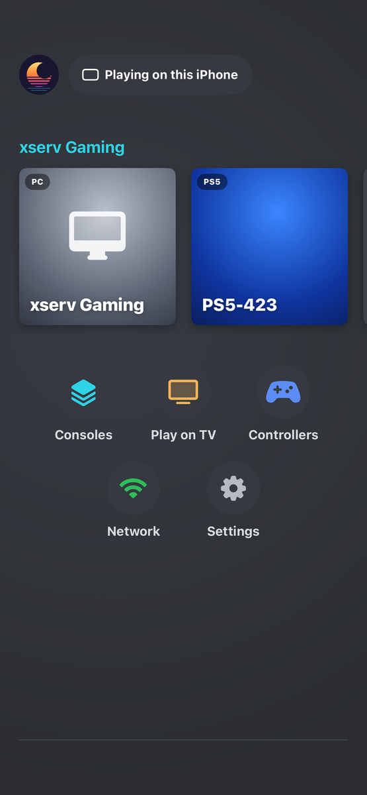
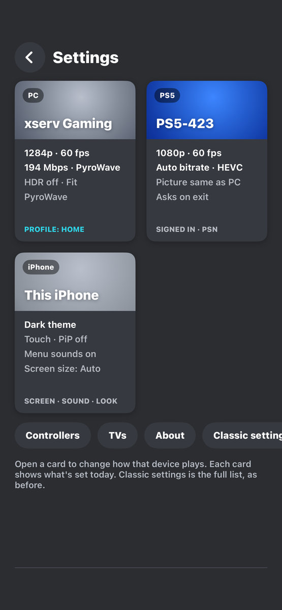
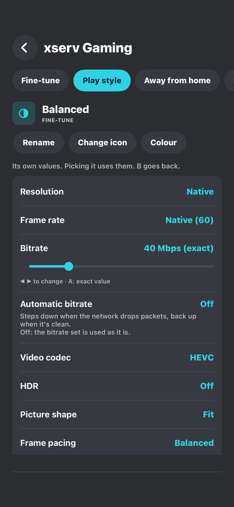
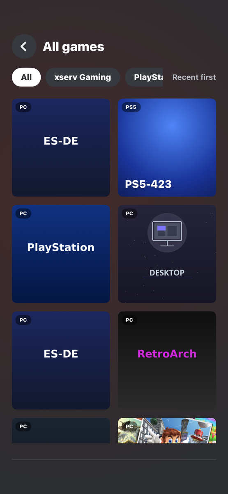
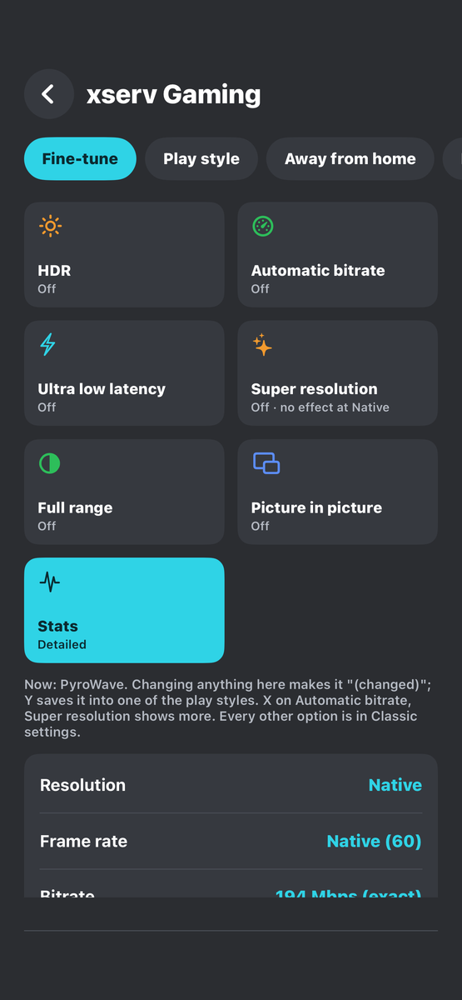

# MoonCast for iPhone and iPad

Play your PC, PS5 and Xbox on an iPhone or iPad.

MoonCast grew from [Moonlight for iOS](https://github.com/moonlight-stream/moonlight-ios) and keeps its streaming engine. The home screen, the console support, the play styles and the TV link are MoonCast's own. The Android app is at [MoonCastDev/moonlight-android](https://github.com/MoonCastDev/moonlight-android).

**Status: beta.** MoonCast for iOS is not on the App Store or TestFlight yet. See [Install](#install).

## Screenshots

| Home | Settings | A play style |
|---|---|---|
|  |  |  |

| All games | Fine-tune |
|---|---|
|  |  |

## What it plays

| | How | What you need |
|---|---|---|
| **PC** | The Moonlight protocol, to [Sunshine](https://github.com/LizardByte/Sunshine), Apollo or Polaris on your PC | Sunshine (or a fork of it), paired once |
| **PS5** | Native PS Remote Play (built on [chiaki-ng](https://github.com/streetpea/chiaki-ng)), at home or away through PlayStation Network | A PlayStation Network sign-in, once, to register the console |
| **Xbox** | Native Xbox Remote Play (WebRTC, following the [XStreaming](https://github.com/Geocld/XStreaming) protocol) | A Microsoft sign-in: the app shows a code, you enter it at microsoft.com/link |

## Features

- **One home** for your PCs, PS5 and Xbox: a tile per PC and console, "playing on" chip, All games with PlayStation and Xbox tabs, the running game first, an Offline badge on PCs that don't answer, and a grid on iPad.
- **Play on TV.** Pick a game and a MoonCast TV on the same Wi-Fi; the TV plays it and your iPhone or iPad becomes the controller.
- **Play styles** for PC (Battery, Balanced, Sharpest, Fastest, PyroWave) and for PS5 and Xbox (Battery, Balanced, Sharpest, Fastest), each with its own page, icon and colour. Fine-tune sits next to them for resolution, frame rate, codec, bitrate and picture.
- **Frame pacing:** Lowest delay, Balanced or Smoothest.
- **PyroWave** (a low-latency, intra-only codec by Themaister) on Apple GPUs, through a Metal port of its decoder. It needs a host that offers it, such as Polaris, and a lot of bandwidth.
- **Automatic bitrate** (off by default). While you play it lowers the bitrate when the network struggles and raises it again after a good minute, and remembers a limit per network.
- **Home and Away profiles**, plus three you name. The PS5 reaches you through PlayStation Network when you're out.
- **Quick menu** while playing: bitrate (changed live), play style, streaming status (Off, Lite or Detailed), controllers with battery level, keyboard, Task Manager, power (hibernate, restart, shut down), Play on TV, disconnect. On a PS5: PS button and Rest mode. On an Xbox: Xbox button and Turn off.
- **PC menu:** Resume, Test the network, Unpair, Remove.
- **Controllers.** Game controllers, a test screen, rumble (dual motor on PS5), the touchscreen as the DualSense touchpad, and an on-screen pad.
- **Picture in picture** for PC and PS5 streams (not for PyroWave or Super resolution streams).
- **Robustness:** a start watchdog, "Remote Play in use" wait on the PS5, switching from PlayStation Network to the home network when the console answers, retries only for "not ready" errors on Xbox.
- **Themes** (including OLED black), and an upright home that turns with the device.

Not here yet: DirectPad, PS4, a MoonCast receiver for Apple TV, using a pad as a mouse. See [MOONCAST-PARITY.md](MOONCAST-PARITY.md).

## Install

**Beta. Not on the App Store or TestFlight yet.** For now, build it from source with Xcode and your own Apple ID. A free Apple ID works, but the app then has to be re-signed every 7 days.

1. Install Xcode (iOS 17 or later on the device).
2. `git clone https://github.com/MoonCastDev/mooncast-ios.git`
3. `cd mooncast-ios && git submodule update --init --recursive`
4. Open `Moonlight.xcodeproj` in Xcode and pick the scheme **Moonlight**.
5. Under Signing & Capabilities, choose your own team and, if Xcode asks, a bundle identifier of your own.
6. Connect the iPhone or iPad (Developer Mode on), choose it as the destination and press Run.

The project name still says Moonlight in places; the app is MoonCast.

### On the PC

Install Sunshine (or Apollo, or Polaris) and pair MoonCast with it as you would with Moonlight. MoonCast needs nothing else on the PC.

## Privacy

MoonCast has no ads and no accounts of its own. Your PlayStation Network and Xbox sign-ins and your PC pairings stay on the device and go only to Sony, Microsoft and your own PC.

Official builds ask once whether you'll send an **anonymous usage check-in** (Settings, About). If you say yes, once a day it sends [TelemetryDeck](https://telemetrydeck.com) the app version, iPhone or iPad, the iOS version, the device model, and whether you played PC, PS5 or Xbox. The install is a random ID made on the device, sent hashed. It never sends names, addresses, games, accounts or anything you type. Say no, or turn it off later, and nothing is sent. Only official builds contain the ID needed to send; a build you make yourself never asks and never sends. The code is in [`Limelight/MoonCast/MCAbout.swift`](Limelight/MoonCast/MCAbout.swift).

## Licence

MoonCast is free software under the [GNU General Public License v3](LICENSE.txt). The app lists the open-source projects it includes under Settings, About.

## Credits

MoonCast stands on the work of:

- **Moonlight**, by Cameron Gutman and its contributors, and **Moonlight X** (GPL-3.0). The streaming engine and the app MoonCast grew from.
- **chiaki-ng**, by streetpea and its contributors, and chiaki before it. It powers PS5 Remote Play.
- **PyroWave**, by Themaister. The codec behind the PyroWave style.
- **XStreaming**, by Geocld. The Xbox Remote Play protocol MoonCast follows.
- **Sunshine**, by LizardByte, on the PC side.

MoonCast isn't affiliated with or endorsed by Apple, Sony Interactive Entertainment, Microsoft or NVIDIA. PlayStation, PS5 and DualSense are trademarks of Sony Interactive Entertainment Inc.; Xbox is a trademark of Microsoft Corporation.
